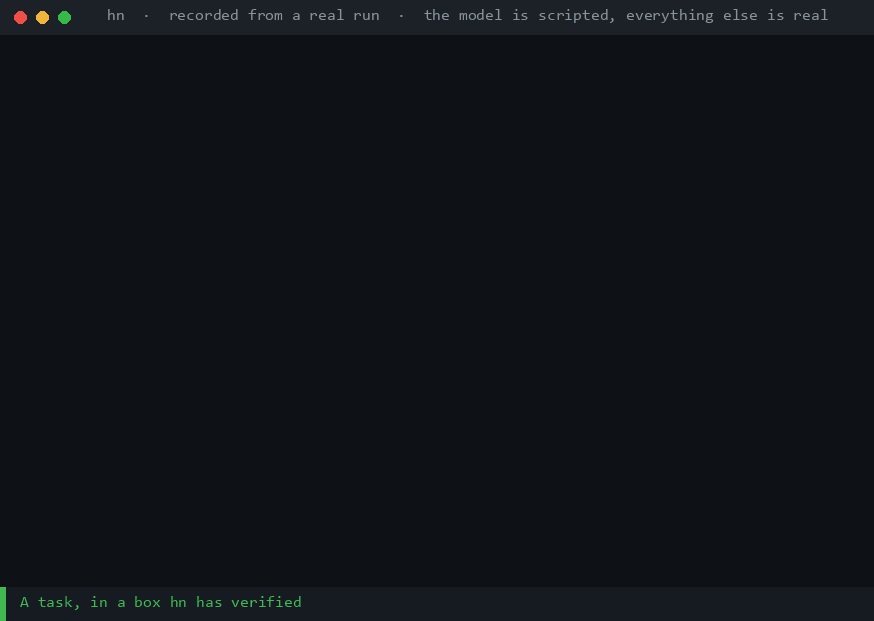

# Haven Harness

**An open-source coding agent built around one idea: an agent should be powerful *and* provably contained.**

Haven Harness (`hn`) is a terminal coding agent that reads, writes and runs code for you, delegates to a crew of
sub-agents, remembers what matters between sessions, and drives whole fleets of repositories. Every action it takes
passes a permission gate. Every command it runs can be put in a sandbox that is **verified from outside**, not trusted
because it says so. Every piece of text it did not get from you is tracked as untrusted, all the way to the gate. For
teams, a self-hosted **broker** holds the model keys and credentials, so the rules bind even a person who edits the
client.

> **Status: early, and moving fast.** The core is built and heavily tested (1,700+ tests, 106 named attacks with a
> test each, all [listed](docs/guide/attacks.md)), but interfaces will still change. Windows is the most-tested platform today. Expect rough edges, and
> please report them.



*Recorded from a real run in the Windows box. The model is scripted so the recording repeats; the box, the approval cards, the edit, the test run and the refusal are real. Re-record it with `scripts/demo/record.ts` and `scripts/demo/render_gif.py`.*

---

## Why another coding agent?

Most agents treat safety as a prompt: "please don't delete my home folder". Haven Harness treats it as engineering.

| | What it means here |
|---|---|
| **A gate on every action** | Each tool call is classified by what it can do (observe, reversible, execution, external, irreversible) and decided by your mode. Nothing runs around the gate, including sub-agents, workflows and scheduled runs. |
| **Sandboxes that are checked, not trusted** | Before a sandbox counts, a canary runs inside it and tries to reach your machine on every address, read a secret outside it, and leave a process behind, while listeners on the host watch. Only what the *host* saw decides. |
| **Untrusted text stays untrusted** | Web pages, MCP servers, repository files and child agents are tagged by origin. A session that has read untrusted text loses the right to act unattended until a person approves. |
| **Your files come back through review** | A sandboxed agent works on a copy. Its changes come back through an import that holds `.git` internals, CI workflows, hooks and links for a person. |
| **A tamper-evident log** | Every session is an append-only log with a chained HMAC. A forged or edited log loads read-only, with no approvals. |
| **Rules that bind, not just advise** | In team mode the laptop holds no model key. A broker checks every model call, server-side tool and memory read against a signed policy, so a modified client gets nothing the policy denies. |
| **A super agent, not just an agent** | A crew of sub-agents, agent teams with a merge queue, scripted workflows, fleets of repositories, loops and schedules: all under the same gate. |

---

## What it can do today

**Work on code**
- Read, write, edit and patch files inside the project, through a path jail that refuses links, hard links and secrets.
- Run shell commands, search with ripgrep, and fetch web pages through an egress policy that blocks private networks,
  cloud metadata and the machine's own addresses.
- Understand a codebase: a **repo map** ranked by PageRank over real tree-sitter symbols, and **LSP** (definition,
  references, hover, diagnostics after every edit) from language servers you configure.
- Look at the web in a **headless browser** whose every request goes through a checking proxy.
- Plan mode, goals and a todo list that survive context compaction; checkpoints, `/rewind` and `/rollback`.

**Work as a super agent**
- **Sub-agents:** a built-in crew (`scout`, `planner`, `worker`, `reviewer`) with narrowed rights; children can never
  hold more than their parent, and parallel writers each get a private git clone.
- **Agent teams** (experimental): a Lead and members sharing a task graph, with a merge queue for their work.
- **Workflows:** short scripts that orchestrate agents and tools (`agent`, `parallel`, `pipeline`), journaled so a
  crashed run resumes.
- **Fleets:** one job file, many repositories, a shared rate limit, results in order, and resume after a crash.
- **Ralph loops and schedules:** repeat a task until a check passes; run prompts on a schedule with the OS scheduler.
- **Steering:** `hn steer` and `hn stop` reach a running session from another terminal.

**Remember**
- `MEMORY.md`, `USER.md` and daily notes per project, recalled when relevant, written only when you ask or approve.
- Search over past sessions; background review and "dream" sweeps that propose, never write, long-term memory.
- Learned skills that are linted, scanned and quarantined until a person accepts them.

**Work as a team** ([docs/guide/team-mode.md](docs/guide/team-mode.md))
- `hn broker`: a self-hosted server that logs people in through your OpenID Connect provider, holds the model keys,
  git tokens and MCP credentials, and applies a **signed policy tree** (organisation, team, role, person).
- Model access, budgets, server-side tools (`git push`, MCP), approvals by someone other than the requester, and
  **team memory** with read gates by person, team and role, all decided on the broker.
- Every decision in a keyed hash chain, shipped to your SIEM over OTLP; each laptop's audit head is anchored there.
  Named readers can search it, follow it live and check an export offline ([docs/guide/team-audit.md](docs/guide/team-audit.md)).

**Meet you where you work**
- A line REPL, a full-screen **TUI** with an approvals inbox, and headless `hn -p` for scripts and CI.
- **ACP** for editors that speak the Agent Client Protocol, a JSON-RPC door, and `hn serve`, a loopback web UI hardened
  against DNS rebinding and CSRF.
- A **VS Code extension** that shows every change the agent wants to make as a diff in VS Code's own diff editor and
  writes nothing until you press **Allow once** ([docs/guide/vscode.md](docs/guide/vscode.md)).
- A **GitHub Action**: a maintainer labels an issue and hn works on it in a verified box, then opens a pull request whose
  description is a report of what the session did. The model's job holds no write token
  ([docs/guide/github-action.md](docs/guide/github-action.md)).
- `hn report <session id>`: a session's report, made from its tamper-evident log, for a pull request.
- `hn serve --replay`: **step through any recorded session** in a browser: each gate decision, approval, taint change and
  diff, with a forged or edited log shown as refused ([docs/guide/replay.md](docs/guide/replay.md)). Read-only, and it
  starts no session.
- **Trust you can check:** [every named attack, with its test](docs/guide/attacks.md), and a
  [hall of fame](docs/guide/hall-of-fame.md) for people who report real holes.

**Models**
- Anthropic, any OpenAI-compatible endpoint, and local models through **Ollama** (`--model ollama/qwen3:14b`).
- **Per-role models:** a cheap or local model reads while a strong one plans and reviews, chosen in `routing.json` and
  checked against your policy when the session opens ([docs/guide/routing.md](docs/guide/routing.md)).
- Every run and fleet job reports **what it cost**, by role and model: tokens, cache hits and dollars, with an unknown
  price shown as unknown, never as zero ([docs/guide/cost.md](docs/guide/cost.md)).
- **Benchmarks you can rerun:** score hn on Terminal-Bench or SWE-bench through Harbor with one resumable, spend-capped
  command that records exactly what it ran ([docs/guide/benchmarks.md](docs/guide/benchmarks.md)).

---

## Sandboxes

| Tier | What | Where |
|---|---|---|
| **Windows native box** | An AppContainer with no capabilities, low integrity, in a Job Object that kills everything when it closes; built in Rust (`native/hn-sandbox`). | Windows 10/11 |
| **Linux native box** | bubblewrap with every namespace unshared and no capability, plus Landlock and seccomp where the kernel has them, each verified from outside; `--sandbox native`. | Linux (needs user namespaces; see [verified on every OS](docs/guide/sandbox-verified.md)) |
| **macOS native box** | A deny-by-default Seatbelt profile with no network, verified from outside; `--sandbox native`. | macOS |
| **Container** | Docker with every confinement asked for, a pinned image, and a quota. Project images come from reviewed recipes (`.hn/sandbox.json`, a devcontainer or a Dockerfile) built with no network. | Any OS with Docker |
| **Plugins** | Your own backend, spoken to over JSON-RPC. Whatever tier it claims is ignored; it earns one only by passing the canary. | Any |
| **None** | The default on a fresh install. The gate still applies, and the banner says **NOT SANDBOXED**. | Any |

`yolo` mode (no prompts) is refused unless the session is in a verified sandbox. What each tier does **not** cover is
listed in [docs/guide/security-model.md](docs/guide/security-model.md).

---

## Quick start

Requirements: **Node 24.14+**. Nothing else: no pnpm, no Rust, no compiler.

```bash
npm install -g haven-harness
hn doctor
```

Or without installing: `npx haven-harness doctor`.

The package runs no install scripts. The one native part, the sandbox helper `hn-sandbox`, is downloaded the first
time a session needs it (or when you run `hn setup`), for your platform only, and **hn refuses it unless its SHA-256
and its signature check** against the key pinned in the package. Offline or air-gapped:
`hn setup --from <folder holding the release's hn-sandbox files>`. All of it is explained in
[docs/guide/install.md](docs/guide/install.md).

Building from source instead (needs **pnpm** via `corepack enable`, and **Rust** stable):

```bash
git clone https://github.com/AkbarSheikh-debug/haven-harness.git
cd haven-harness
corepack enable
pnpm install --frozen-lockfile
pnpm build:sandbox          # builds native/hn-sandbox (the safe file helper, the Windows box, and Landlock and seccomp on Linux)
node packages/surfaces/bin/hn.mjs doctor
```

Give it a model:

```bash
# Anthropic
export ANTHROPIC_API_KEY=...            # PowerShell: $env:ANTHROPIC_API_KEY = "..."
hn

# A local model through Ollama
hn --model ollama/qwen3:14b

# Any OpenAI-compatible server
hn --model <name> --base-url http://localhost:8000/v1

# Through your team's broker (no key on this machine)
hn login https://broker.example.com
hn --team --model <a model the policy allows you>
```

From a source checkout, make an alias: `alias hn="node /path/to/haven-harness/packages/surfaces/bin/hn.mjs"`.

### Common commands

```bash
hn                                   # interactive session in the current folder
hn tui                               # full-screen session with an approvals inbox
hn -p "fix the failing test"         # one headless turn, for scripts and CI
hn -p "..." --sandbox native --mode yolo   # unattended, in this OS's verified native box
hn --resume <session> | --continue   # pick a session back up
hn doctor                            # check the install, the sandbox and Docker
hn fleet jobs.json --workers 4       # many repositories, one job file
hn ralph "make the tests pass" --check "pnpm test" --max 10
hn schedule add --name nightly --rrule "FREQ=DAILY" "summarise yesterday's commits"
hn steer <session> "focus on the parser first"
hn serve | hn acp | hn rpc           # web UI, editors, JSON-RPC
hn serve --replay                    # step through recorded sessions (read-only); add --follow for a live one
hn audit search --type broker/approval-   # the team's audit, from your broker (see docs/guide/team-audit.md)
hn sandbox show | propose | build    # project image recipes
hn prepare --image <name>@sha256:... # install dependencies through a locked-down proxy
hn login <broker> | hn logout        # team mode
hn approvals [approve|deny <id>]     # requests waiting for you, as an approver
hn broker broker.json                # run a broker (see docs/guide/team-mode.md)
hn setup                             # fetch and verify the sandbox helper now (otherwise at first use)
hn update <release.tgz>              # install a newer signed release
```

**Modes:** `read-only`, `plan`, `safe`, `accept-edits`, `smart`, `dont-ask` (with `--allow`), and `yolo` (verified
sandbox only). In a session, try `/agents`, `/compact`, `/checkpoints`, `/rewind`, `/memory`, `/handoff`, `/learn`.

---

## Project layout

```
packages/
  core          events, errors and shared types
  session       the append-only, HMAC-chained session log
  provider      Anthropic, OpenAI-compatible, Ollama and broker adapters, retries, prices
  context       budgets, compaction, skills, instructions
  loop          the agent loop: turns, tools, compaction, memory hooks
  security      the gate, modes, taint, path jail, egress policy, redaction, command parsing, policy, OIDC
  operations    the only package that starts processes: sandboxes, git, LSP, browser, proxies
  tools         the tools the model sees
  memory        notes, recall, dream sweeps, learned skills
  delegate      sub-agents, roles, grants and the child channel
  orchestrate   fleets, workflows, teams, ralph, schedules, the supervisor
  broker        hn broker: login, tokens, governed model calls, server-side tools, approvals, audit, team memory
  release       signed releases: deterministic archives, the manifest, the SBOM, the update verifier
  surfaces      the CLI and every door: REPL, TUI, -p, RPC, ACP, serve
  config        defaults
  testkit       fake models, a fake identity provider and helpers for tests
  evals         benchmark tasks
native/hn-sandbox   Rust: safe file access, keychain, and the Windows native box
scripts/            release build and release-age audit
```

See [docs/guide/architecture.md](docs/guide/architecture.md) for how the pieces fit together.

---

## Development

```bash
pnpm typecheck     # tsc --noEmit
pnpm test          # the full suite (about 5 minutes)
pnpm test:sandbox  # the Rust helper's tests
node --disable-proto=throw --test packages/security/test/gate.test.ts   # one file
```

Tests that need Docker or a live model skip themselves; set `HN_LIVE_OLLAMA=1` with Ollama running to include the
live-model tests.

## Contributing

Contributions are welcome: bug reports, fixes, new tools, new sandbox backends, docs and tests. Start with
[CONTRIBUTING.md](CONTRIBUTING.md). Security issues go through [SECURITY.md](SECURITY.md), not public issues.

## License

Copyright 2026 Akbar Sheikh. Licensed under the [Apache License, Version 2.0](LICENSE): use it, fork it, change it and
ship it, commercially or not, keeping the license and the [NOTICE](NOTICE).
